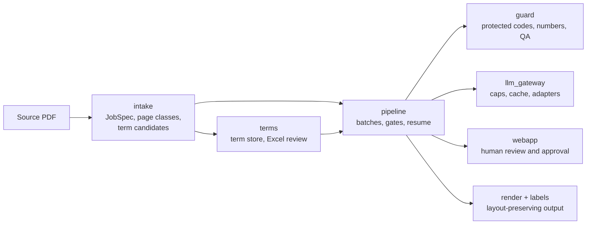

# Manuvi

**Translate long technical manuals from English to Vietnamese while keeping their terminology, figure references and diagrams intact.**

Manuvi turns an OEM service manual (hundreds of pages of procedures, wiring diagrams, troubleshooting flowcharts and parts tables) into a Vietnamese document a repair technician can actually use in the workshop. It is built for a real first user: a heavy-equipment repair workshop working from an English excavator shop manual.

> Status: **early, working pipeline.** Intake, term store, guarded batch pipeline and a local review web app run offline with fakes ($0). The pre-rewrite workflow is archived under `legacy/` (see `docs/LEGACY-MIGRATION.md`).

*Tiếng Việt:* Manuvi dịch tài liệu kỹ thuật dài (manual sửa chữa, sơ đồ điện, lưu đồ chẩn đoán) từ tiếng Anh sang tiếng Việt, giữ đúng thuật ngữ, số hình và sơ đồ, để thợ sửa máy dùng được ngay.

---

## Why this is hard

Machine translation of a sentence is solved. Translating a *manual* is not:

| Problem | What goes wrong with a generic translator | What Manuvi does |
|---|---|---|
| Terminology | The same part gets three different Vietnamese names across chapters | Curated EN→VI glossary injected per chunk, checked after translation |
| Identifiers | Part numbers (`YT…`), connector codes and `Fig. 23-11` references get translated or dropped | Protected tokens are whitelisted and verified by QA |
| Structure | Headings, lists and line breaks collapse into paragraphs | Block-level parsing keeps reading order and line structure from the PDF |
| Diagrams | Wiring diagrams are images; labels stay in English | Diagram pages are detected; labels are extracted and given Vietnamese legends |
| Flowcharts | Troubleshooting flowcharts lose their decision structure | Flowchart pages are redrawn with translated boxes |
| Trust | Nobody knows which pages are wrong | Automated QA reports, random page sampling and an Excel review loop for a technician |

## How it works



| Package | Responsibility |
|---|---|
| `src/intake` | Page classification, JobSpec, protected-code patterns, term candidates (offline, no LLM) |
| `src/terms` | Term store, proposals/Excel round trip, prompt term injection |
| `src/guard` | Masking of protected codes, number checks, QA rules |
| `src/pipeline` | LangGraph batch pipeline with SQLite checkpoints, gates and resume |
| `src/llm_gateway` | The only path to a model: budget caps, cache, adapters |
| `src/webapp` | Local review app (127.0.0.1, token) |
| `src/render`, `src/labels` | Font fitting, overlay, diagram label merge |
| `src/ingest`, `src/glossary`, `src/models.py` | PDF parsing, figure extraction, noise filter, diagram labels, glossary seed (kept from the first version) |

## Quick start

Requirements: Python 3.13.

```bash
git clone https://github.com/HuyenTrang0506/manuvi.git
cd manuvi
pip install -e .

manuvi intake manual.pdf --sections "23:1-42,43:1-22" --out-dir workspace/intake
manuvi terms propose --help
manuvi pipeline demo --help        # synthetic job, fake adapter, $0
manuvi webapp --jobdir workspace/job
```

`python -m src.cli ...` works too. Paid model calls only go through `src/llm_gateway` with caps.

Run the tests (offline):

```bash
python -m pytest
```

## Project layout

```
src/            application code (see table above)
config/         profiles, prices, signal words
docs/           job format, agent context, team roles, legacy migration
legacy/         archived first-version code, prompts, docs (not imported, not packaged)
tests/          offline tests
spikes/         throwaway experiments
data/, workspace/, output/   git-ignored
```

## Data and copyright

OEM manuals are copyrighted. This repository contains **no manual content**: source PDFs, extracted text, figures and outputs live in git-ignored folders and are used only for the end user's own internal repair work. Public demos use public-domain technical documents.

## Roadmap

- [ ] Automated translation step on Amazon Bedrock, replacing the semi-manual workflow
- [ ] Stateful translation graph (LangGraph): classify → translate → QA → bounded self-correction → human review, with checkpoints so long jobs resume after failure
- [ ] LLM observability (Langfuse): traces per step, token usage, cost per page, latency, prompt versions
- [ ] Frozen evaluation set and CI regression gate (chrF/COMET, terminology accuracy, untranslated blocks per page)
- [ ] Layout-preserving PDF output (Vietnamese text placed back into the original page layout)
- [ ] Diagram callout detection model to place Vietnamese labels directly on wiring diagrams
- [ ] Fine-tuned small translation model for repetitive segments, trained and deployed with SageMaker Pipelines and Model Registry

## Author

Built by [Nguyen Huyen Trang](https://github.com/HuyenTrang0506).
