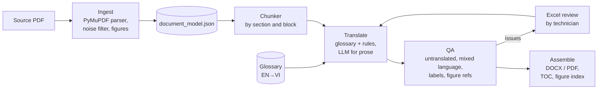

# Manuvi

**Translate long technical manuals from English to Vietnamese while keeping their terminology, figure references and diagrams intact.**

Manuvi turns an OEM service manual (hundreds of pages of procedures, wiring diagrams, troubleshooting flowcharts and parts tables) into a Vietnamese document a repair technician can actually use in the workshop. It is built for a real first user: a heavy-equipment repair workshop working from an English excavator shop manual.

> Status: **early, working pipeline.** Ingest, glossary, QA and DOCX/PDF assembly run end to end on the electrical chapters (64 pages) of a 1,012-page excavator shop manual. The translation step is being moved from a semi-manual workflow to an automated, evaluated LLM pipeline (see [Roadmap](#roadmap)).

*Tiếng Việt:* Manuvi dịch tài liệu kỹ thuật dài (manual sửa chữa, sơ đồ điện, lưu đồ chẩn đoán) từ tiếng Anh sang tiếng Việt, giữ đúng thuật ngữ, số hình và sơ đồ, để thợ sửa máy dùng được ngay.

---

## Why this is hard

Machine translation of a sentence is solved. Translating a *manual* is not:

| Problem | What goes wrong with a generic translator | What Manuvi does |
|---|---|---|
| Terminology | The same part gets three different Vietnamese names across chapters | Curated EN→VI glossary injected per chunk, checked after translation |
| Identifiers | Part numbers (`YT…`), connector codes and `Fig. 23-11` references get translated or dropped | Protected tokens are whitelisted and verified by QA |
| Structure | Headings, lists and line breaks collapse into paragraphs | Block-level parsing keeps reading order and line structure from the PDF |
| Diagrams | Wiring diagrams are images; labels stay in English | Diagram pages are detected; labels are extracted and given Vietnamese legends |
| Flowcharts | Troubleshooting flowcharts lose their decision structure | Flowchart pages are redrawn with translated boxes |
| Trust | Nobody knows which pages are wrong | Automated QA reports, random page sampling and an Excel review loop for a technician |

## How it works



Main modules:

| Package | Responsibility |
|---|---|
| `src/ingest` | Parse the PDF into blocks with page/section references (`23-15` style), strip repeated headers and footers, extract figures and diagram regions |
| `src/glossary` | Load, merge and apply the EN→VI term base (seed: `src/glossary/seeds/construction_electrical_en_vi.csv`) |
| `src/translate` | Chunking, glossary/phrase-rule engine, caption and list translation, diagram label and legend translation (vision model optional), flowchart redraw |
| `src/qa` | Page classification, untranslated-term collection, mixed-language detection, label and legend audits, page sampling and output tests |
| `src/assemble` | Build the Vietnamese DOCX/PDF with Unicode fonts, table of contents, figure index and label tables |
| `src/excel` | Export pending or flagged items to Excel for a human reviewer and import corrections back |

## Quick start

Requirements: Python 3.9+.

```bash
git clone https://github.com/HuyenTrang0506/manuvi.git
cd manuvi
pip install -e .

# Put your source PDF in data/ (ignored by git), then:
python -m src.cli run-all                 # ingest → chunk → glossary
python -m src.cli status                  # translation progress
python -m src.cli translate-all           # glossary + rule engine on pending chunks
python -m src.cli qa                      # QA report in workspace/<doc>/qa/
python -m src.cli assemble --pdf          # DOCX + PDF in output/<doc>/vi/
```

Useful commands:

| Command | What it does |
|---|---|
| `classify-pages` | Tag each page as prose, table, wiring diagram, flowchart… |
| `review-samples --count 8 --seed 42` | Random page sample with a pass/warn/fail review report |
| `export-excel` / `import-excel` | Round-trip pending or flagged items with a human reviewer |
| `collect-untranslated` / `audit-mix` | Find English left in the output and mixed-language lines |
| `vision-legends` | Read diagram labels with a vision model (needs `OPENAI_API_KEY` or `ANTHROPIC_API_KEY`) |
| `test-output` | Check the built DOCX/PDF: Vietnamese fonts, figure labels, files present |

Run the tests:

```bash
python -m pytest tests
```

## Project layout

```
src/            pipeline code (ingest, glossary, translate, qa, assemble, excel, cli)
prompts/        translation prompt for the electrical chapters
docs/           design notes: source analysis, architecture, glossary and translation pipelines, risks
tests/          unit tests
data/           source PDFs (git-ignored)
workspace/      per-document intermediate state (git-ignored)
output/         generated documents (git-ignored)
```

## Data and copyright

OEM manuals are copyrighted. This repository contains **no manual content**: source PDFs, extracted text, figures and outputs live in git-ignored folders and are used only for the end user's own internal repair work. Public demos use public-domain technical documents.

## Roadmap

- [ ] Automated translation step on Amazon Bedrock, replacing the semi-manual workflow
- [ ] Stateful translation graph (LangGraph): classify → translate → QA → bounded self-correction → human review, with checkpoints so long jobs resume after failure
- [ ] LLM observability (Langfuse): traces per step, token usage, cost per page, latency, prompt versions
- [ ] Frozen evaluation set and CI regression gate (chrF/COMET, terminology accuracy, untranslated blocks per page)
- [ ] Layout-preserving PDF output (Vietnamese text placed back into the original page layout)
- [ ] Diagram callout detection model to place Vietnamese labels directly on wiring diagrams
- [ ] Fine-tuned small translation model for repetitive segments, trained and deployed with SageMaker Pipelines and Model Registry

## Author

Built by [Nguyen Huyen Trang](https://github.com/HuyenTrang0506).
