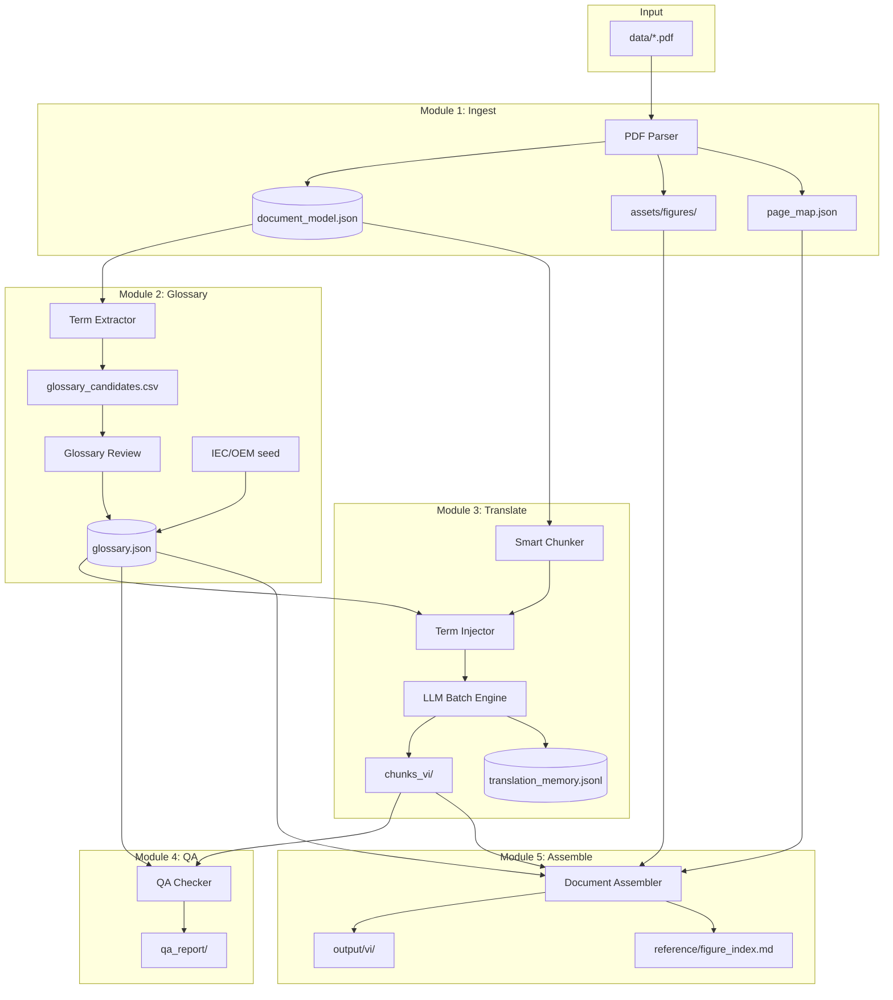
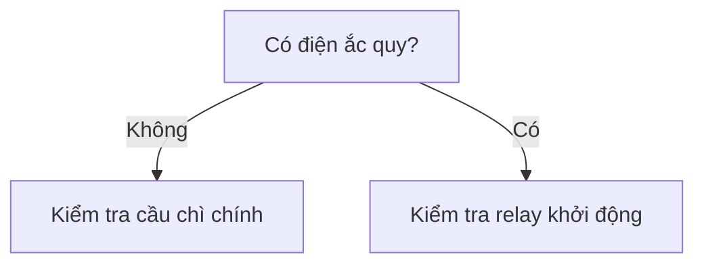

# Kiến trúc hệ thống

## 1. Tổng quan

Hệ thống gồm **5 module** chạy tuần tự, có thể resume từng job. Không cần microservices — monorepo Python là đủ.



## 2. Cấu trúc thư mục dự án

```
translator-electronic/
├── data/                          # PDF gốc (gitignore nếu lớn)
│   └── 382014584-sk70sr-1es-shop-manual.pdf
├── docs/                          # Tài liệu kế hoạch (folder này)
├── src/
│   ├── ingest/
│   │   ├── parser.py              # PyMuPDF → document model
│   │   ├── figure_extractor.py
│   │   └── noise_filter.py        # Strip copyright footer
│   ├── glossary/
│   │   ├── extractor.py           # Term candidates
│   │   ├── manager.py             # CRUD glossary
│   │   └── seeds/                 # IEC, automotive EN-VI
│   ├── translate/
│   │   ├── chunker.py
│   │   ├── engine.py              # LLM API batch + resume
│   │   └── prompts.py
│   ├── qa/
│   │   ├── consistency.py
│   │   └── number_guard.py
│   └── assemble/
│       ├── docx_builder.py
│       ├── pdf_builder.py
│       └── figure_index.py
├── workspace/                     # Generated per document (gitignore)
│   └── sk70sr-1es/
│       ├── document_model.json
│       ├── chunks/
│       ├── chunks_vi/
│       ├── assets/figures/
│       ├── glossary.json
│       └── jobs/                  # Job state for resume
├── output/                        # Final deliverables
└── scripts/
    ├── run_ingest.sh
    ├── run_translate.sh
    └── run_assemble.sh
```

## 3. Document Model (schema cốt lõi)

Mọi thứ xoay quanh `document_model.json` — **single source of truth** sau ingestion.

```json
{
  "doc_id": "sk70sr-1es",
  "source_file": "382014584-sk70sr-1es-shop-manual.pdf",
  "total_pdf_pages": 1012,
  "pages": [
    {
      "pdf_page": 201,
      "manual_ref": "23-15",
      "section": "23. ELECTRICAL SYSTEM",
      "blocks": [
        {
          "block_id": "p201_b0",
          "type": "heading",
          "text_en": "23. ELECTRICAL SYSTEM",
          "font_size": 10.0,
          "bbox": [x, y, w, h]
        },
        {
          "block_id": "p201_b2",
          "type": "figure",
          "figure_id": "fig-23-11",
          "image_path": "assets/figures/p201_fig23-11.png",
          "caption_en": "Fig. 23-11  Upper electric assy (2/2)",
          "caption_vi": null,
          "manual_ref": "23-15",
          "pdf_page": 201
        },
        {
          "block_id": "p201_b4",
          "type": "paragraph",
          "text_en": "23.2.5 UPPER ELECTRIC ASSY (2/2)...",
          "text_vi": null,
          "protected_tokens": ["YT13E01079P1"]
        }
      ]
    }
  ],
  "figures_registry": {
    "fig-23-11": {
      "figure_number": "23-11",
      "caption_en": "Upper electric assy (2/2)",
      "caption_vi": null,
      "pdf_pages": [201],
      "manual_refs": ["23-15"],
      "image_paths": ["assets/figures/p201_fig23-11.png"]
    }
  }
}
```

### Block types

| Type | Xử lý dịch | Output |
|------|------------|--------|
| `heading` | Dịch title, giữ số mục | Heading VI |
| `paragraph` | Dịch full | Paragraph VI |
| `caption` | Dịch, giữ `Fig. 23-11` | Caption VI |
| `figure` | Chỉ dịch caption; ảnh giữ gốc | Ảnh + caption VI |
| `table` | Dịch header + cột Name | Bảng rendered |
| `warning` | Dịch + flag review bắt buộc | Box cảnh báo VI |
| `footer` | Strip, không dịch | Loại bỏ |
| `page_ref` | Không dịch (`23-15`) | Giữ nguyên |

## 4. Hệ thống anchor & đối chiếu trang gốc

### Quy tắc hiển thị trong output

Mỗi trang/block VI có **dual reference**:

```
┌─────────────────────────────────────────────────────┐
│ 23. ĐIỆN / ELECTRICAL SYSTEM          [23-15]    │
│ ─────────────────────────────────────────────────  │
│ (Trang PDF gốc: 201)                               │
│                                                     │
│ 23.2.5 LẮP RÁP ĐIỆN PHẦN TRÊN (2/2)               │
│ ...nội dung dịch...                                │
│                                                     │
│ ┌─────────────────────────────────┐                │
│ │  [Ảnh gốc — Hình 23-11]         │                │
│ └─────────────────────────────────┘                │
│ Hình 23-11. Lắp ráp điện phần trên (2/2)          │
│ (Gốc: Fig. 23-11 — Upper electric assy (2/2))     │
└─────────────────────────────────────────────────────┘
```

### `page_map.json`

```json
{
  "23-15": { "pdf_page": 201, "section": "23", "vi_output_page": null },
  "23-16": { "pdf_page": 202, "section": "23", "vi_output_page": null }
}
```

Sau assemble, fill `vi_output_page` để tra cứu 2 chiều.

## 5. Figure Index (deliverable bắt buộc)

File `reference/figure_index.md` — auto-generated:

```markdown
# Danh mục hình ảnh / Figure Index

| Hình gốc | Trang manual | Trang PDF | Tiêu đề EN | Tiêu đề VI | File ảnh |
|----------|--------------|-----------|------------|------------|----------|
| Fig. 23-11 | 23-15 | 201 | Upper electric assy (2/2) | Lắp ráp điện phần trên (2/2) | p201_fig23-11.png |
| Fig. 23-12 | 23-15 | 201 | E/G room light harness | Bộ dây đèn phòng E/G | p201_fig23-12.png |
```

→ Đáp ứng yêu cầu: *không vẽ lại mạch nhưng reader biết hình nào ở đâu so với gốc*.

## 6. Tech stack

| Layer | Công nghệ | Lý do |
|-------|-----------|-------|
| Language | Python 3.11+ | Ecosystem PDF/NLP |
| PDF parse | PyMuPDF (fitz) | Nhanh, bbox + image extract |
| Tables | pdfplumber (fallback) | Bảng phức tạp |
| Data model | Pydantic v2 | Validate schema |
| Storage | SQLite + JSON files | Đủ cho 1 project, không cần Postgres MVP |
| LLM | Claude API / OpenAI API | Batch, cache system prompt |
| DOCX output | python-docx | Chỉnh sửa tiếp |
| PDF output | WeasyPrint hoặc docx→pdf | Render final |
| CLI | Typer | `translate run --doc sk70sr-1es --section 23` |
| Job state | JSON files in `jobs/` | Resume: `--from-chunk 142` |

### Vai trò Cursor Pro

| Việc | Dùng Cursor |
|------|-------------|
| Viết & debug toàn bộ `src/` | ✅ Chính |
| Review chunk low-confidence | ✅ |
| Dịch 1.012 trang qua chat | ❌ |
| Chạy batch production | ❌ — dùng API script |

## 7. Luồng CLI đề xuất

```bash
# Bước 1: Parse PDF
python -m src.cli ingest data/382014584-sk70sr-1es-shop-manual.pdf --doc-id sk70sr-1es

# Bước 2: Extract terms
python -m src.cli glossary extract --doc-id sk70sr-1es --section 23

# Bước 3: Review glossary (interactive hoặc edit CSV)
python -m src.cli glossary import --doc-id sk70sr-1es glossary_reviewed.csv

# Bước 4: Translate (resumable)
python -m src.cli translate run --doc-id sk70sr-1es --section 23 --resume

# Bước 5: QA
python -m src.cli qa check --doc-id sk70sr-1es

# Bước 6: Assemble
python -m src.cli assemble --doc-id sk70sr-1es --format docx,pdf
```

## 8. Mermaid — phạm vi hạn chế

Chỉ dùng cho **sơ đồ logic đơn giản** (nếu detect được), ví dụ flow troubleshooting:



**Không áp dụng** cho:
- Wiring harness diagram (Fig. 23-11)
- Hydraulic/Electrical schematics có symbol chuẩn
- Exploded view drawings

Quy tắc: `mermaid_attempt` chỉ tạo khi figure có ≤15 node text và không có part number pattern; luôn giữ ảnh gốc làm primary.
