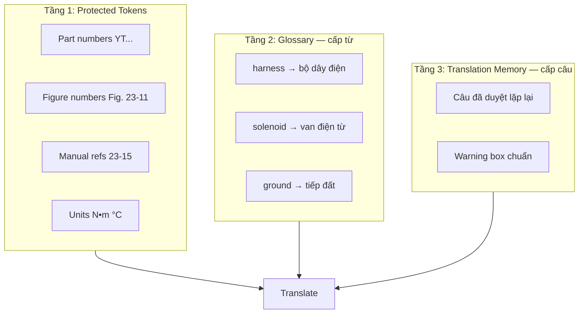

# Pipeline Glossary & Corpus

## 1. Tại sao glossary phải làm trước (và song song)

Manual Kobelco SK70SR có:
- **212.000 từ** — cùng thuật ngữ lặp hàng trăm lần (`sensor` ×427, `connector` ×274)
- **249 mã harness** — sai 1 ký tự = không tra được phụ tùng
- **Cùng khái niệm, nhiều cách dịch** — `ground` / `earth` / `mass` trong automotive

Không có glossary → bản dịch **không dùng được** cho KTV sửa máy.

## 2. Ba tầng từ vựng



## 3. Nguồn corpus cho domain máy xúc / điện Kobelco

| Nguồn | Ưu tiên | Cách dùng |
|-------|---------|-----------|
| **Manual này (extract)** | P0 | Term extraction từ section 23, 43 trước |
| Manual Kobelco khác (nếu có bản VI) | P0 | Bitext alignment |
| Từ điển kỹ thuật EN-VI (TDKT, FAO) | P1 | Seed 500–1000 term |
| Forum / catalog VN (Kobelco, Hitachi…) | P2 | Tên thường gọi VN |
| ISO/IEC automotive terms | P2 | Chuẩn hóa |
| Bản dịch đã review từ project | P0 | Tích lũy liên tục |

## 4. Pipeline thu thập từ vựng

### Phase A: Auto-extract (tuần 1)

```bash
python -m src.cli glossary extract --doc-id sk70sr-1es
```

**Phương pháp kết hợp:**

1. **Regex patterns** — part numbers, acronyms (ECU, CAN, A/C)
2. **Frequency + TF-IDF** — cụm từ lặp trong section 21–25
3. **Noun phrase extraction** — `Upper electric assy`, `pilot valve`
4. **LLM extraction** — prompt: "List technical terms, do NOT translate"

**Output:** `workspace/sk70sr-1es/glossary_candidates.csv`

```csv
term_en,frequency,sections,suggested_vi,confidence,status,source
harness,222,"23,33,34",,0.0,draft,extract
solenoid,127,"22,23,24",,0.0,draft,extract
ground,80,"23,43",,0.0,draft,extract
YT13E01079P1,3,23,,1.0,protected,regex
```

### Phase B: Seed glossary (tuần 1–2)

File `src/glossary/seeds/construction_machinery_en_vi.csv` — 200–300 term phổ biến:

```csv
term_en,term_vi,do_not_translate,notes
harness,bộ dây điện,false,
wire harness,bộ dây điện,false,synonym
solenoid valve,van điện từ,false,
ground,tiếp đất,false,NOT "đất"
mass,tiếp khung,false,automotive context
relay,rơ-le,false,giữ dấu gạch
ECU,ECU,true,giữ nguyên
OBD,OBD,true,
```

### Phase C: Human review (tuần 2–3)

**Mục tiêu pilot (section 23+43):** 250 term `approved`  
**Mục tiêu full manual:** 800–1.200 term `approved`

Quy trình review:
1. Sort theo `frequency` DESC
2. Review top 50/ngày
3. Mark: `approved` | `rejected` | `protected` | `synonym_of`
4. Mỗi term có `context_example` từ manual gốc

**UI tối thiểu:** CSV trong Excel/Google Sheets hoặc Streamlit app đơn giản.

### Phase D: Lock version trước batch

```
glossary_v0.5  → pilot section 23
glossary_v1.0  → wave 1 (book 2)
glossary_v1.1  → sau review wave 1, re-run inconsistent chunks
```

Mỗi chunk translated lưu `glossary_version` để biết cần re-run khi nào.

## 5. Schema Glossary Entry

```json
{
  "id": "term-0042",
  "term_en": "harness",
  "term_vi": "bộ dây điện",
  "variants_en": ["wire harness", "electric harness"],
  "variants_vi": ["bộ dây", "dây điện"],
  "domain": "electrical",
  "do_not_translate": false,
  "case_sensitive": false,
  "definition_en": "Bundle of wires with connectors",
  "context_examples": [
    {
      "anchor_id": "p201_b4",
      "sentence_en": "E/G ROOM LIGHT HARNESS : YT13E01079P1"
    }
  ],
  "status": "approved",
  "source": "human",
  "confidence": 1.0,
  "version": "1.0",
  "updated_at": "2026-07-29T00:00:00Z"
}
```

## 6. Term injection khi dịch

### Chọn glossary subset cho mỗi chunk

Không inject cả 1.000 term — chỉ term **xuất hiện trong chunk**:

```python
def glossary_subset(chunk_text: str, glossary: list) -> list:
    return [t for t in glossary if t.term_en.lower() in chunk_text.lower()
            or any(v.lower() in chunk_text.lower() for v in t.variants_en)]
```

### System prompt template

```
Bạn dịch Shop Manual máy xúc thủy lực Kobelco từ tiếng Anh sang tiếng Việt.

QUY TẮC BẮT BUỘC:
1. Dùng ĐÚNG thuật ngữ trong GLOSSARY (không thay đổi).
2. KHÔNG dịch: mã phụ tùng (YT...), số hình (Fig. 23-11), số mục (23.2.5), đơn vị số.
3. Giữ format: (1) (2) (3) cho các bước thủ tục.
4. WARNING/CAUTION/DANGER → CẢNH BÁO/CẨN THẬN/NGUY HIỂM.
5. Cross-reference: "See Fig. 23-11" → "Xem Hình 23-11".

GLOSSARY:
{glossary_subset}

TRANSLATION MEMORY (câu tương tự đã duyệt):
{tm_matches}
```

## 7. Post-translation consistency check

```bash
python -m src.cli qa terms --doc-id sk70sr-1es
```

| Check | Mô tả | Action |
|-------|-------|--------|
| `unmapped_en_term` | Thuật ngữ EN còn trong bản VI | Thêm glossary / re-translate |
| `inconsistent_term` | Cùng EN → nhiều VI | Flag + human fix |
| `protected_violation` | Mã YT bị đổi | Auto-revert |
| `figure_ref_drift` | `Fig. 23-11` bị đổi số | Auto-revert |

## 8. Translation Memory (TM)

Lưu câu/đoạn đã `approved` — ưu tiên reuse trước khi gọi LLM:

```jsonl
{"source_en": "Always disconnect the battery before servicing.", "target_vi": "Luôn ngắt kết nối ắc quy trước khi bảo dưỡng.", "anchor_id": "p190_b3", "glossary_version": "1.0"}
```

**Fuzzy match ≥95%** → copy từ TM, không tốn API.

Manual Kobelco có nhiều câu lặp (safety precautions, torque notes) → TM tiết kiệm **15–25%** API cost.

## 9. Lộ trình glossary theo wave

| Wave | Scope | Target terms | Thời gian |
|------|-------|--------------|-----------|
| Pilot | Sec 23, 43 | 250 approved | Tuần 1–2 |
| Wave 1 | Sec 21–25 | +300 = 550 | Tuần 3–4 |
| Wave 2 | Sec 31–34 | +250 = 800 | Tuần 5–7 |
| Wave 3 | Còn lại | +200 = 1.000 | Tuần 8–10 |
| Maintenance | Sau mỗi wave | Review drafts | Liên tục |

## 10. Câu trả lời trực tiếp

**Có cần pipeline corpus trước?**  
→ Có, nhưng **không chờ hoàn hảo**. Seed 200 term + extract từ pilot → đủ chạy section 23.

**Có cần lưu từ đã dịch?**  
→ **Bắt buộc.** `glossary.json` + `translation_memory.jsonl` là tài sản tái sử dụng cho manual Kobelco khác (SK series…).
