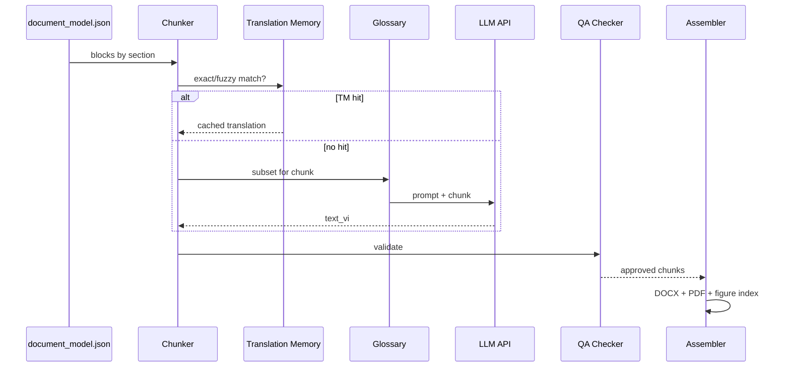

# Pipeline dịch & lắp ráp output

## 1. Tổng quan luồng dịch



## 2. Smart chunking

### Nguyên tắc

| Không làm | Nên làm |
|-----------|---------|
| Cắt giữa câu | 1 block = 1 chunk (đã parse) |
| Gộp nhiều section | Chunk trong cùng `manual_ref` |
| Tách caption khỏi figure | Figure chunk = caption only; ảnh attach metadata |

### Chunk size thực tế (manual này)

| Block type | Avg words | Chunk strategy |
|------------|-----------|----------------|
| paragraph | 50–200 | 1 block = 1 chunk |
| heading | 5–15 | Gộp với paragraph đầu tiên sau |
| table | 100–500 | 1 table = 1 chunk; split nếu >800 từ |
| warning | 30–100 | 1 chunk + flag `requires_review` |
| caption | 5–20 | 1 chunk |

**Ước lượng chunk count:**
- Pilot (sec 23+43, ~64 trang): **~180–250 chunks**
- Full manual (1.012 trang): **~3.500–4.500 chunks**

### Chunk file format

`workspace/sk70sr-1es/chunks/p201_b4.json`:

```json
{
  "chunk_id": "p201_b4",
  "doc_id": "sk70sr-1es",
  "pdf_page": 201,
  "manual_ref": "23-15",
  "section": "23. ELECTRICAL SYSTEM",
  "block_type": "paragraph",
  "text_en": "23.2.5 UPPER ELECTRIC ASSY (2/2) 23.2.5-10 E/G ROOM LIGHT HARNESS : YT13E01079P1",
  "protected_tokens": ["YT13E01079P1", "23.2.5", "23.2.5-10"],
  "glossary_terms": ["harness", "assy"],
  "status": "pending",
  "text_vi": null
}
```

## 3. Translation engine

### Tại sao không dùng Cursor chat

| | Cursor chat | API batch script |
|--|-------------|------------------|
| 4.000 chunks | Hàng trăm giờ thao tác | Chạy qua đêm |
| Resume | Khó | `--resume` từ chunk_id |
| Glossary inject | Thủ công | Tự động mỗi chunk |
| Cost | Pro quota | ~$80–200 predictable |
| Consistency | Thấp | Cao (cùng prompt version) |

**Cursor Pro dùng để:** viết `engine.py`, debug prompt, review output — không phải runtime.

### Batch config

```yaml
# workspace/sk70sr-1es/translate_config.yaml
model: claude-sonnet-4-20250514  # hoặc gpt-4o
max_tokens: 4096
temperature: 0.1
concurrency: 5
retry: 3
rate_limit_rpm: 60
sections: ["23", "43"]  # pilot
glossary_version: "0.5"
prompt_version: "v1"
```

### Resume & job state

`workspace/sk70sr-1es/jobs/translate_state.json`:

```json
{
  "job_id": "translate-20260729-001",
  "total_chunks": 220,
  "completed": 142,
  "failed": 2,
  "last_chunk_id": "p215_b3",
  "started_at": "...",
  "api_tokens_used": 185000
}
```

```bash
# Tiếp từ chunk bị gián đoạn
python -m src.cli translate run --doc-id sk70sr-1es --resume

# Chỉ re-run chunk failed
python -m src.cli translate run --doc-id sk70sr-1es --only-failed
```

### Ước lượng chi phí API

| Scope | Chunks | Input tokens | Output tokens | Cost (Sonnet-class) |
|-------|--------|--------------|---------------|---------------------|
| Pilot sec 23+43 | ~220 | ~150K | ~120K | **$3–8** |
| Book 2 (sec 21–25) | ~900 | ~600K | ~480K | **$15–35** |
| Full manual | ~4.000 | ~2.5M | ~2M | **$80–180** |

*Giảm 15–25% nhờ TM cache cho câu lặp.*

## 4. Xử lý đặc biệt theo block type

### 4.1 Warning / Safety (Section 0 — ưu tiên cao)

```json
{ "block_type": "warning", "requires_review": true, "priority": "P0" }
```

- Dịch xong → luôn vào `review_queue.json`
- Cursor/human review 100% warnings trước khi assemble

### 4.2 Tables (torque, parts list)

**Pipeline riêng:**

1. Parse table → `rows[]` với column roles: `no | name | qty | torque`
2. Dịch chỉ cột `name` + header
3. Render lại table trong DOCX (python-docx `add_table`)

**Không** dịch bảng bằng LLM free-text — dễ lệch cột.

### 4.3 Figures

```
Output per figure:
├── Ảnh gốc (extracted PNG)
├── Caption VI
├── Metadata: Fig. 23-11, manual_ref 23-15, pdf_page 201
└── Optional: link trong figure_index.md
```

**Không** embed Mermaid thay wiring diagram.

### 4.4 Cross-references

Post-process regex sau dịch:

| EN | VI |
|----|-----|
| See Fig. 23-11 | Xem Hình 23-11 |
| See page 23-15 | Xem trang 23-15 |
| Section 23.2.5 | Mục 23.2.5 |
| WARNING | CẢNH BÁO |
| CAUTION | THẬN TRỌNG |
| DANGER | NGUY HIỂM |

Giữ nguyên số: `23-11`, `23.2.5`, `YT13E01079P1`.

## 5. QA tự động

```bash
python -m src.cli qa check --doc-id sk70sr-1es --section 23
```

### QA report

`workspace/sk70sr-1es/qa/report.json`:

```json
{
  "summary": {
    "total_chunks": 220,
    "translated": 218,
    "failed": 2,
    "review_required": 12,
    "term_inconsistencies": 5
  },
  "issues": [
    {
      "chunk_id": "p195_b2",
      "type": "inconsistent_term",
      "term_en": "ground",
      "variants_vi": ["tiếp đất", "mass"],
      "action": "retranslate_with_glossary"
    }
  ]
}
```

### Human review queue (ưu tiên)

1. `requires_review: true` (warnings)
2. `confidence < 0.7` từ LLM self-score
3. `term_inconsistencies`
4. Tables với >10 rows
5. Random sample 5% còn lại

## 6. Document Assembler

### Output chính: DOCX

**Lý do DOCX trước PDF:** Dễ chỉnh bảng/hình sau assemble; KTV có thể sửa trực tiếp.

Cấu trúc DOCX:

```
1. Trang bìa (tên manual VI + model SK70SR-1ES)
2. Mục lục (generate từ sections parsed)
3. Hướng dẫn đối chiếu bản gốc
4. Danh mục hình ảnh (Figure Index)
5. Nội dung theo section
   └── Mỗi trang: header [23-15] + (PDF gốc: 201)
6. Phụ lục: glossary thuật ngữ chính
```

### Output phụ

| File | Mục đích |
|------|----------|
| `shop_manual_vi.pdf` | Đọc/distribure |
| `shop_manual_bilingual.pdf` | Đối chiếu (optional, 2x dung lượng) |
| `figure_index.md` | Tra hình nhanh |
| `page_map.json` | Tool/API tra cứu |
| `glossary_v1.json` | Tái sử dụng |

### Template block trong DOCX

**Paragraph:**
```
[23-15 | Gốc: tr.201]
23.2.5 LẮP RÁP ĐIỆN PHẦN TRÊN (2/2)
23.2.5-10 BỘ DÂY ĐÈN PHÒNG E/G: YT13E01079P1
```

**Figure:**
```
┌──────────────────────────────┐
│  [Hình 23-11 — ảnh gốc]      │
│  (PDF gốc trang 201)         │
└──────────────────────────────┘
Hình 23-11. Lắp ráp điện phần trên (2/2)
EN: Fig. 23-11 — Upper electric assy (2/2)
```

## 7. Phương án bán tự động (nếu không có API budget)

Nếu **chỉ có Cursor Pro, không API:**

| Bước | Công cụ | Khả thi |
|------|---------|---------|
| Parse PDF | Script local | ✅ |
| Chunk → files | Script | ✅ |
| Dịch từng chunk | Cursor chat + glossary.md | ⚠️ Chỉ pilot ~50 trang |
| Assemble | Script | ✅ |

**Giới hạn thực tế không API:** ~50–80 trang manual/tháng (session thủ công).

→ Với 1.012 trang: **12–20 tháng** hoặc chất lượng không đồng nhất.

**Khuyến nghị:** Budget **$80–180 API** cho full run — ROI rõ ràng so với thời gian.

**Engine review:** Excel (`export-excel` / `import-excel`) — xem [09-EXCEL-WORKFLOW.md](./09-EXCEL-WORKFLOW.md)

## 8. Re-run strategy

Khi cập nhật `glossary_v0.5 → v1.0`:

```bash
# Chỉ re-translate chunks có term bị ảnh hưởng
python -m src.cli translate rerun \
  --doc-id sk70sr-1es \
  --glossary-diff glossary_v0.5.json glossary_v1.0.json
```

Không cần dịch lại 4.000 chunk — thường chỉ **10–20%** bị ảnh hưởng.
