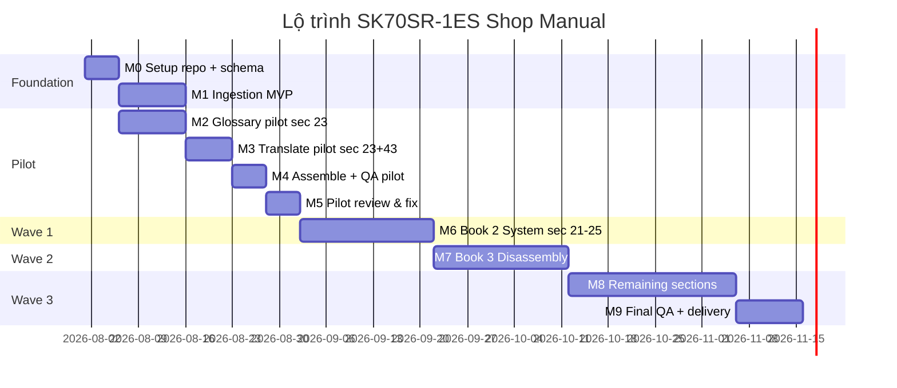

# Lộ trình triển khai

## Tổng quan timeline



**Tổng:** ~14–16 tuần (1 developer + KTV review part-time)

---

## Milestone 0: Setup (Tuần 1 — 5 ngày)

### Mục tiêu
Repo có thể chạy `ingest` trên PDF thật.

### Tasks

- [ ] Init Python project (`pyproject.toml`, dependencies: pymupdf, pydantic, typer, python-docx)
- [ ] Define Pydantic models: `Document`, `Page`, `Block`, `Figure`, `GlossaryEntry`, `Chunk`
- [ ] `.gitignore`: `workspace/`, `output/`, `data/*.pdf` (optional)
- [ ] CLI skeleton: `python -m src.cli --help`

### Done criteria
```bash
python -m src.cli ingest data/382014584-sk70sr-1es-shop-manual.pdf --doc-id sk70sr-1es
# → workspace/sk70sr-1es/document_model.json exists
# → ≥600 figures extracted to assets/
```

---

## Milestone 1: Ingestion MVP (Tuần 1–2)

### Mục tiêu
Parse đầy đủ 1.012 trang thành document model có cấu trúc.

### Tasks

- [ ] `noise_filter.py` — strip copyright footer
- [ ] `parser.py` — block classification (heading/paragraph/caption/figure/table)
- [ ] `figure_extractor.py` — extract images + link captions via regex `Fig. XX-YY`
- [ ] Build `page_map.json` — map `manual_ref` ↔ `pdf_page`
- [ ] Build `figures_registry` — 675 unique figures
- [ ] Unit test: page 201 (electrical) có đúng 2 figures + captions

### Done criteria
- `document_model.json` < 50MB
- 675 figures in registry (±5%)
- Section 23 pages: 187–228 correctly tagged
- Zero copyright footer in `text_en` fields

---

## Milestone 2: Glossary pilot (Tuần 2–3)

### Mục tiêu
250 approved terms cho electrical domain.

### Tasks

- [ ] `extractor.py` — term candidates từ sec 23, 43
- [ ] Seed file 200 construction machinery terms
- [ ] Export `glossary_candidates.csv` sorted by frequency
- [ ] Human review top 250 → `glossary_v0.5.json`
- [ ] Whitelist 249 harness part numbers as `protected`

### Done criteria
- `glossary_v0.5.json` với ≥250 `status: approved`
- 100% harness codes marked `protected`
- Top 20 terms (`sensor`, `connector`, `harness`…) có `term_vi`

---

## Milestone 3: Translate pilot (Tuần 3–4)

### Mục tiêu
Dịch section 23 + 43 (~220 chunks).

### Tasks

- [ ] `chunker.py` — generate chunks từ document model
- [ ] `engine.py` — LLM batch với glossary inject + resume
- [ ] `prompts.py` — v1 system prompt (test trên 10 chunks)
- [ ] Configure API key (env var `ANTHROPIC_API_KEY` hoặc `OPENAI_API_KEY`)
- [ ] Run batch sec 23 + 43
- [ ] TM: lưu câu safety lặp lại

### Done criteria
- ≥98% chunks `status: done`
- QA: 0 `protected_violation`
- QA: <5% `term_inconsistencies`
- API cost pilot: <$10

---

## Milestone 4: Assemble pilot (Tuần 4)

### Mục tiêu
Output DOCX + figure index cho section 23.

### Tasks

- [ ] `docx_builder.py` — render blocks với dual page reference
- [ ] `figure_index.py` — generate markdown table 54+ figures (sec 23)
- [ ] `pdf_builder.py` — DOCX → PDF (optional tuần này)
- [ ] Sample output review với KTV

### Done criteria
- `output/sk70sr-1es/vi/section_23_vi.docx` readable
- `reference/figure_index_sec23.md` complete
- KTV confirm: tra được Hình 23-11 → đúng ảnh gốc

---

## Milestone 5: Pilot review (Tuần 4–5)

### Mục tiêu
Validate pipeline end-to-end, fix issues trước scale.

### Checklist review

| # | Kiểm tra | Pass? |
|---|----------|-------|
| 1 | Warning boxes dịch đúng, không sai nghĩa an toàn | |
| 2 | Part numbers YT... không bị đổi | |
| 3 | Figure numbers giữ nguyên | |
| 4 | Torque values không đổi | |
| 5 | Thuật ngữ điện nhất quán trong sec 23 | |
| 6 | Cross-ref "See Fig." đúng format | |
| 7 | Footer copyright không xuất hiện trong bản VI | |
| 8 | Page map tra cứu 2 chiều hoạt động | |

### Output
- `docs/pilot-retrospective.md` — lessons learned
- `glossary_v1.0.json` — updated từ pilot feedback
- Go/No-go decision cho Wave 1

---

## Milestone 6: Wave 1 — Book 2 System (Tuần 5–8)

### Scope
Sections 21–25 (~266 page-hits, ~900 chunks)

| Section | Nội dung | Ưu tiên glossary |
|---------|----------|------------------|
| 21 | Mechatro control | Cao |
| 22 | Hydraulic | Cao |
| 23 | Electrical | ✅ Done (pilot) |
| 24 | Components | Trung bình |
| 25 | Air-conditioner | Trung bình |

### Tasks
- [ ] Extend glossary +300 terms
- [ ] Translate sec 21, 22, 24, 25
- [ ] Table pipeline cho maintenance specs
- [ ] Assemble book 2 DOCX

---

## Milestone 7: Wave 2 — Book 3 Disassembly (Tuần 8–11)

### Scope
Sections 31–34 (~253 page-hits)

### Đặc thù
- Nhiều torque tables → table pipeline bắt buộc
- Exploded views → figure index critical
- Procedure steps (1)(2)(3) → giữ format

---

## Milestone 8: Wave 3 — Remaining (Tuần 11–14)

### Scope
- Book 0: Safety (section 0)
- Book 1: Maintenance (11–14)
- Book 4: Troubleshooting (41–44, 43 done)
- Book 5–6: Engine + Options (63)

---

## Milestone 9: Final delivery (Tuần 14–16)

### Tasks
- [ ] Merge all sections → full `shop_manual_vi.docx`
- [ ] Full figure index (675 figures)
- [ ] Final QA pass
- [ ] `glossary_v1.final.json` export
- [ ] Documentation handover

---

## Ưu tiên nếu thiếu thời gian

Nếu không kịp full 1.012 trang, ưu tiên theo giá trị sử dụng:

| Ưu tiên | Section | Trang | Lý do |
|---------|---------|-------|-------|
| P0 | 0 (Safety) | ~15 | An toàn |
| P0 | 23 (Electrical) | 42 | Core yêu cầu |
| P0 | 43 (Troubleshooting electric) | 22 | Sửa chữa |
| P1 | 22 (Hydraulic) | 54 | Liên quan điện-thủy lực |
| P1 | 11–13 (Maintenance) | ~62 | Bảo dưỡng định kỳ |
| P2 | 33–34 (Disassembly) | ~208 | Tháo lắp |
| P3 | 63 (Options) | ~90 | Phụ kiện |

---

## Effort estimate

| Role | Giờ/tuần | Tuần | Tổng giờ |
|------|----------|------|----------|
| Dev (build pipeline) | 15–20 | 14 | 210–280h |
| KTV (glossary + review) | 5–8 | 14 | 70–112h |
| **Tổng** | | | **280–392h** |

---

## Sprint đầu tiên đề xuất (bắt đầu ngay)

**Sprint 1 (2 tuần):** M0 + M1 + M2 partial

```
Tuần 1:
  Day 1-2: Project setup + Pydantic models
  Day 3-5: Parser + noise filter, test page 201

Tuần 2:
  Day 1-3: Full ingest 1012 pages + figure extract
  Day 4-5: Term extract sec 23, seed glossary, review top 100
```

**Deliverable Sprint 1:**
- `document_model.json` complete
- `glossary_v0.3.json` with 100 approved terms
- Demo: page 201 rendered as JSON with figures
