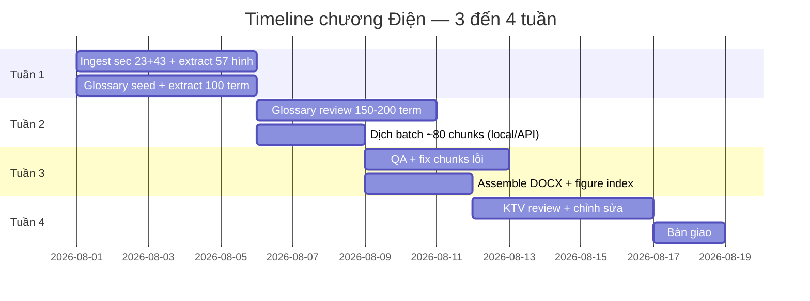
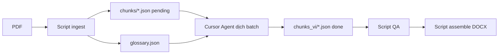
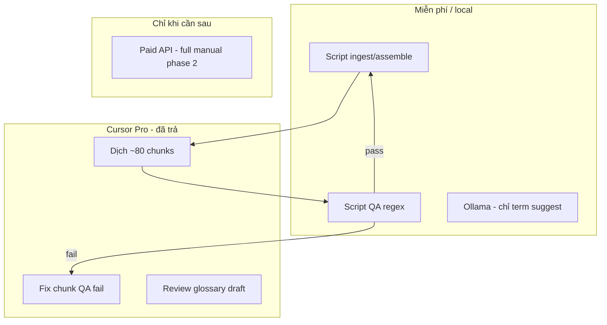

# Requirements — Ưu tiên chương Điện + Tối ưu chi phí

**Cập nhật:** 2026-07-29  
**Scope chính thức:** Chương điện (không phải full 1.012 trang)

---

## 1. Phạm vi yêu cầu (Requirements)

### 1.1 In-scope (bắt buộc)

| Section | Tên | PDF pages | ~Từ | ~Chunks | Hình |
|---------|-----|-----------|-----|---------|------|
| **23** | ELECTRICAL SYSTEM | 42 (187–228) | 5.262 | ~35 | 57 |
| **43** | TROUBLESHOOTING (ELECTRIC) | 22 (661–682) | 6.880 | ~45 | 0 |
| **Tổng core** | | **64** | **~12.142** | **~80** | **57** |

**Deliverable bắt buộc:**
- Bản dịch VI section 23 + 43 (DOCX + PDF)
- **Excel review:** `workspace/sk70sr-1es/excel/translation.xlsx` (chunks, labels, captions, glossary)
- Figure index 57 hình điện (số gốc ↔ caption VI ↔ trang PDF ↔ `23-15`)
- `page_map.json` cho toàn bộ section 23, 43
- Glossary điện ~150–200 term (approved)
- Giữ ảnh wiring diagram gốc, không vẽ lại

### 1.2 In-scope (khuyến nghị thêm)

| Section | Tên | Lý do | Pages |
|---------|-----|-------|-------|
| **0** | SAFETY PRECAUTIONS | Cảnh báo an toàn khi làm điện | ~13 |
| **23.x refs in 33–34** | Disassembly harness/connector | Tra cứu tháo lắp dây điện | Tùy chọn phase 2 |

### 1.3 Out-of-scope (giai đoạn này)

- Full manual 1.012 trang
- Book Hydraulic (22), Engine (51), Options (63)…
- Mermaid redraw wiring diagram
- Layout pixel-perfect như bản OEM

### 1.4 Non-functional requirements

| ID | Yêu cầu |
|----|---------|
| NFR-1 | Mọi block có `manual_ref` gốc (`23-15`) + `pdf_page` |
| NFR-2 | Part number `YT...` không được thay đổi |
| NFR-3 | `Fig. 23-XX` giữ nguyên số, chỉ dịch caption |
| NFR-4 | **Chi phí thêm: $0** — tận dụng Cursor Pro đã có |
| NFR-5 | Engine dịch chính: **Cursor agent** (Claude), không Ollama bulk |
| NFR-6 | Pipeline resume được khi gián đoạn (file-based chunks) |
| NFR-7 | **Excel export/import** — KTV chỉnh `translation.xlsx` rồi build lại PDF |
| NFR-8 | Cấu trúc text giữ xuống dòng gốc (`\n`); ref `23-15`, `Fig. 23-XX` không đổi |
| NFR-9 | Nhãn sơ đồ: mỗi dòng một nghĩa VI (sheet `labels`), không substring match |
| NFR-10 | Nhãn OCR dính chữ → đánh dấu `[⚠ OCR]` + `guess_note` (cột suspicion trong Excel) |
| NFR-11 | PDF dùng font Unicode (Arial Unicode) — **tự test** sau mỗi `assemble` |
| NFR-12 | **`test-pages`** — kiểm tra **từng trang** (64): chunk, label, ảnh, PDF marker, font VI |

---

## 2. Bao lâu dịch xong? (Timeline thực tế)

### 2.1 Scope điện only (23 + 43) — **khuyến nghị**



| Giai đoạn | Thời gian | Ai làm |
|-----------|-----------|--------|
| Build pipeline + ingest | 5–7 ngày | Dev (Cursor) |
| Glossary 150–200 term | 5–7 ngày | Dev extract + KTV review |
| Dịch ~80 chunks | **4–8 phiên Cursor** (~10 chunk/phiên) | Bạn + agent |
| QA tự động + fix | 2–3 ngày | Dev + script |
| Assemble output | 1–2 ngày | Script |
| Review KTV | 3–5 ngày | KTV điện |
| **Tổng** | **3–4 tuần** | |

> **Lưu ý:** 64 trang PDF nghe nhiều, nhưng chỉ **~12.000 từ** (5.7% cả manual) vì nhiều trang là wiring diagram. Đây là scope **nhỏ**, khả thi nhanh.

### 2.2 Nếu thêm Safety (section 0)

| Thêm | Pages | Từ | Thời gian cộng |
|------|-------|-----|----------------|
| Section 0 | 13 | ~4.535 | +1 tuần (glossary safety + review 100% warnings) |

**Tổng với Safety:** 4–5 tuần.

### 2.3 So sánh với full manual (tham khảo)

| Scope | Trang | Từ | Tuần | Chi phí API |
|-------|-------|-----|------|-------------|
| **Điện only (23+43)** | 64 | 12K | **3–4** | **$0–5** |
| Điện + Safety | 77 | 17K | 4–5 | $0–8 |
| Full manual | 1.012 | 213K | 14–16 | $80–180 |

---

## 3. Ollama local — hạn chế thực tế (quan trọng)

Bạn nói đúng: **Qwen2.5:14b không có data dịch chuyên ngành** máy xúc/điện Kobelco.

| Vấn đề với Ollama bulk | Hậu quả |
|------------------------|---------|
| Không biết `harness` = bộ dây điện (không phải "yên ngựa") | Thuật ngữ sai |
| `ground` / `mass` / `earth` lẫn lộn | KTV không tin bản dịch |
| Không hiểu context `E/G room`, `pilot valve` | Dịch word-by-word |
| Không có fine-tune Kobelco part number | Hay sửa mã `YT...` |

**Kết luận:** Ollama **không phù hợp làm engine dịch chính** cho tài liệu kỹ thuật này.  
Có thể dùng Ollama **phụ** cho: gợi ý thuật ngữ ban đầu, draft không quan trọng — không tin vào output.

---

## 4. Cursor ở giữa pipeline — khuyến nghị chính

Với **~80 chunks** (scope điện), tích hợp Cursor vào **tầng dịch** là hợp lý và **tốt hơn Ollama** — vì bạn đã trả Pro, model mạnh hơn, follow glossary tốt hơn.

### 4.1 Khác gì với "chat dịch thủ công"?

Trước đó mình nói không nên chat dịch 1.000 trang — vẫn đúng. Nhưng đây là **pipeline có cấu trúc**:



**Cursor không copy-paste từng đoạn.** Cursor đọc file chunk + glossary, ghi file output, script track `status: done`.

### 4.2 Workflow cụ thể mỗi phiên Cursor

```bash
# Script chuẩn bị sẵn trước
workspace/sk70sr-1es/
├── chunks/           # 80 file, status: pending
├── glossary.json     # 150 term approved
└── prompts/translate.md   # Prompt cố định
```

**Prompt mẫu cho agent (mỗi phiên ~8–10 chunk):**

```
Dịch các file trong workspace/sk70sr-1es/chunks/ có status=pending,
ưu tiên batch tiếp theo (tối đa 10 file).

Quy tắc:
- Đọc glossary.json, dùng ĐÚNG term_vi đã approved
- Không đổi: YT..., Fig. 23-XX, số mục 23.2.5, đơn vị N•m
- Ghi output vào chunks_vi/{chunk_id}.json
- Cập nhật status=done trong chunk gốc
```

**Ước lượng:** 80 chunks ÷ 10 = **8 phiên** × 15–20 phút = **2–3 giờ** thao tác (rải 2–3 ngày).

### 4.3 Vì sao Cursor tốt hơn Ollama cho case này

| Tiêu chí | Ollama qwen2.5:14b | **Cursor (Claude)** |
|----------|-------------------|---------------------|
| Thuật ngữ chuyên ngành | Yếu — không có domain data | Khá — hiểu context kỹ thuật |
| Follow glossary 150 term | TB — hay bỏ qua | **Tốt** — nhất quán hơn nhiều |
| Part number `YT...` | Hay sửa sai | Ít lỗi hơn + dễ fix trong session |
| Warning/Caution | Rủi ro cao | Đáng tin hơn |
| Chi phí thêm | $0 | **$0** (đã có Pro) |
| Tự động qua đêm | Có | Không — cần trigger phiên |
| Scale 1.000 trang | Được (chậm) | Không khuyến nghị |
| **Scale 80 chunk điện** | Chất lượng thấp | **✅ Sweet spot** |

### 4.4 Vai trò từng engine (cập nhật)



| Tầng | Engine | Việc |
|------|--------|------|
| Ingest / Assemble / QA | Python script | Tự động 100% |
| **Dịch chính** | **Cursor agent** | ~80 chunks |
| Glossary suggest | Ollama hoặc Cursor | Draft term_vi |
| Glossary approve | KTV + bạn | Human |
| Full manual sau này | Paid API batch | Khi >500 chunks |

---

## 5. Tối ưu chi phí — chiến lược đầy đủ

### 5.1 Nguyên tắc (cập nhật)

1. **Scope nhỏ** — sec 23+43 (~80 chunks)
2. **Cursor Pro = engine dịch** — đã trả, không tốn thêm API
3. **Script làm phần nặng** — parse, QA, assemble (không tốn quota)
4. **Glossary trước** — giảm sửa lại trong mỗi phiên Cursor
5. **Ollama không dùng bulk dịch** — chỉ suggest term nếu cần
6. **Paid API** — chỉ khi scale full manual (phase sau)

### 5.2 Bảng so sánh phương án (scope điện)

| Phương án | Chi phí thêm | Chất lượng | Khuyến nghị |
|-----------|--------------|------------|-------------|
| Ollama bulk | $0 | 5–6/10 — thiếu domain | ❌ Không |
| **Cursor pipeline (file-based)** | **$0** | **8–9/10** | **✅ Chính** |
| Cursor copy-paste thủ công | $0 | 6/10 — không nhất quán | ❌ Không |
| Paid API (Haiku/mini) | $2–5 | 8.5/10 | Tùy chọn nếu hết quota |
| Paid API (Sonnet) | $8–15 | 9/10 | Overkill cho 80 chunk |

### 5.3 Cấu hình engine đề xuất

```yaml
# translate_config.yaml — scope điện
primary_engine: cursor              # Agent đọc/ghi file chunk
chunks_per_session: 10
sections: ["23", "43"]
glossary_path: workspace/sk70sr-1es/glossary.json
glossary_version: "1.0"
prompt_path: prompts/translate_electrical.md

# Không dùng cho bulk dịch
ollama:
  enabled: false                    # hoặc chỉ term_suggest: true

# Phase sau — full manual
api_fallback:
  enabled: false
  model: claude-3-5-haiku-20241022
```

### 5.4 Tiết kiệm quota Cursor

| Kỹ thuật | Tiết kiệm quota |
|----------|-----------------|
| Script ingest/QA/assemble — không qua agent | Phần lớn công việc |
| 10 chunks/phiên, không nhét cả section | Context gọn |
| Glossary inject 1 file, không paste từng term | Ít token lặp |
| TM: câu đã dịch → script copy, không hỏi agent | −15% chunk |
| Strip footer copyright trước khi chunk | −5% token/chunk |
| Agent chỉ đọc `pending` chunks | Không dịch lại chunk done |

---

## 6. Đánh giá khả thi cập nhật (scope điện)

| Hạng mục | Full manual | **Chương điện + Cursor** |
|----------|-------------|--------------------------|
| Khả thi tổng | 78% | **94%** |
| Timeline | 14–16 tuần | **3–4 tuần** |
| Chi phí thêm | $80–180 API | **$0** (Cursor Pro) |
| Engine dịch | API batch | **Cursor agent** |
| Hình cần index | 675 | **57** |
| Glossary cần | 800–1200 | **150–200** |
| KTV review | 40–80h | **8–15h** |

---

## 7. Lộ trình rút gọn (Cursor-centric)

### Tuần 1 — Setup + Ingest
- [ ] Parse PDF pages 187–228, 661–682
- [ ] Extract 57 hình + captions
- [ ] Chunk → 80 file JSON `status: pending`
- [ ] Seed + extract glossary → review draft 150 term

### Tuần 2 — Dịch qua Cursor
- [ ] KTV approve glossary (3–4h)
- [ ] **8 phiên Cursor**: dịch 10 chunk/phiên, ghi `chunks_vi/`
- [ ] Script QA sau mỗi batch

### Tuần 3 — Output
- [x] Script assemble DOCX + PDF (PyMuPDF)
- [x] **Excel export/import** cho KTV review
- [x] Engine dịch nhãn sơ đồ (`retranslate-labels`)
- [ ] KTV review warnings + 57 caption hình (qua Excel sheet `labels` / `captions`)

### Tuần 4 — Bàn giao
- [ ] Chỉnh theo feedback Excel → `import-excel` → export PDF
- [ ] Lưu `glossary_v1.json` + TM

---

## 10. Excel workflow (bắt buộc từ 2026-07-29)

KTV/reviewer **không sửa JSON trực tiếp** — dùng Excel:

```bash
PYTHONPATH=. python3 -m src.cli export-excel
# Sửa translation.xlsx (sheets: chunks, labels, captions, glossary)
PYTHONPATH=. python3 -m src.cli import-excel --file workspace/sk70sr-1es/excel/translation.xlsx
PYTHONPATH=. python3 -m src.cli assemble --pdf
```

Chi tiết: [09-EXCEL-WORKFLOW.md](./09-EXCEL-WORKFLOW.md)

**Cập nhật requirement docs** sau mỗi cải tiến pipeline (remap, labels, Excel, v.v.).

---

## 9. Rủi ro & mitigation (Cursor path)

| Rủi ro | Mức | Mitigation |
|--------|-----|------------|
| Hết quota Cursor giữa chừng | TB | 10 chunk/phiên; TM cache; nghỉ giữa các ngày |
| Agent bỏ qua glossary | Thấp | QA script flag term lệch → phiên fix riêng |
| Session mất context | TB | File-based: mọi thứ trong `chunks_vi/`, resume bất cứ lúc nào |
| Thuật ngữ mới giữa chừng | TB | Thêm vào glossary.json → chỉ re-dịch chunk liên quan |
| Sửa nhãn sơ đồ thủ công | Thấp | Sheet `labels` trong Excel → `import-excel` |

---

## 11. Quyết định đề xuất (cập nhật)

**Scope:** Section 23 + 43 (64 trang, ~12K từ, 57 hình)  
**Engine dịch:** **Cursor agent** (file-based, ~8 phiên) — không Ollama bulk  
**Review KTV:** **Excel** (`translation.xlsx`) → `import-excel` → PDF  
**Ollama:** Không dùng dịch chính (thiếu domain data)  
**Timeline:** **3–4 tuần**  
**Chi phí thêm:** **$0** (tận dụng Cursor Pro)

Phase 2: section 0 Safety. Phase 3 full manual → cân nhắc paid API batch.
