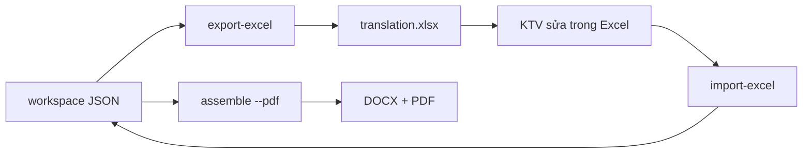

# Excel Workflow — Chỉnh sửa bản dịch & xuất PDF

**Cập nhật:** 2026-07-29

Workflow chính thức để KTV/reviewer chỉnh bản dịch **ngoài pipeline** rồi build lại DOCX/PDF.

---

## 1. Tổng quan



| Bước | Lệnh | Ai làm |
|------|------|--------|
| Xuất Excel | `export-excel` | Script |
| Chỉnh sửa | Mở `.xlsx` | KTV / reviewer |
| Import | `import-excel` | Script |
| Build output | `assemble --pdf` | Script |

---

## 2. File Excel

**Đường dẫn mặc định:** `workspace/sk70sr-1es/excel/translation.xlsx`

### Sheets

| Sheet | Nội dung | Cột sửa được |
|-------|----------|--------------|
| `README` | Hướng dẫn | — |
| `chunks` | Văn bản đoạn, TOC, flowchart | `text_vi`, `review_notes` |
| `labels` | Chú thích ký hiệu sơ đồ mạch | `label_vi`, `review_notes` |
| `captions` | Tiêu đề hình Fig. 23-XX | `caption_vi`, `review_notes` |
| `glossary` | Thuật ngữ EN→VI | `term_vi`, `status`, `notes` |

### Quy tắc chỉnh sửa

1. **Chỉ sửa cột có ✏️** — các cột khóa (ID, EN gốc) giữ nguyên.
2. **Giữ xuống dòng** trong ô Excel: `Alt+Enter` (Windows) / `Control+Option+Enter` (Mac).
3. **Không đổi** `chunk_id`, `figure_id`, `text_en`, `label_en` — dùng làm khóa import.
4. **Part number** `YT...`, số hình `23-11`, ref `23-15` — giữ nguyên trong `text_vi`.

---

## 3. Lệnh CLI

```bash
# Xuất Excel (sau ingest + dịch)
PYTHONPATH=. python3 -m src.cli export-excel

# Xuất ra đường dẫn tùy chọn
PYTHONPATH=. python3 -m src.cli export-excel --out workspace/sk70sr-1es/excel/review_v2.xlsx

# Import sau khi KTV sửa
PYTHONPATH=. python3 -m src.cli import-excel --file workspace/sk70sr-1es/excel/translation.xlsx

# Build DOCX + PDF
PYTHONPATH=. python3 -m src.cli assemble --pdf
```

### Workflow đầy đủ sau mỗi cải tiến pipeline

```bash
PYTHONPATH=. python3 -m src.cli retranslate-labels   # nếu sửa engine nhãn
PYTHONPATH=. python3 -m src.cli export-excel        # sync Excel mới nhất
# ... KTV review Excel ...
PYTHONPATH=. python3 -m src.cli import-excel --file workspace/sk70sr-1es/excel/translation.xlsx
PYTHONPATH=. python3 -m src.cli qa
PYTHONPATH=. python3 -m src.cli assemble --pdf
```

---

## 4. Import — cập nhật gì?

| Sheet | Ghi vào |
|-------|---------|
| `chunks` | `workspace/.../chunks/*.json` → `text_vi`, `status=done` |
| `labels` | `document_model.json` → `figures_registry[].labels` + block labels |
| `captions` | `figures_registry[].caption_vi` + chunk caption liên quan |
| `glossary` | `glossary/glossary.json` → `term_vi`, `status` |

Sau `import-excel`, chạy `assemble` để cập nhật:

- `output/sk70sr-1es/vi/section_electrical_vi.docx`
- `output/sk70sr-1es/vi/section_electrical_vi.pdf`

---

## 5. Bảng nhãn trong DOCX/PDF

Bảng **"Chú thích các ký hiệu trên hình"** trong output lấy từ sheet `labels`.

Cột trái = `label_en`, cột phải = `label_vi` (sau import).

---

## 6. Phụ thuộc

- `openpyxl>=3.1.0` (trong `pyproject.toml`)
- Cài: `pip install openpyxl`

---

## 7. Tự kiểm tra output (bắt buộc)

### 7.1 Smoke test (`test-output`)

```bash
PYTHONPATH=. python3 -m src.cli test-output
```

| Check | Ý nghĩa |
|-------|---------|
| `docx_exists` | File DOCX tồn tại |
| `pdf_vietnamese_font` | PDF có ký tự tiếng Việt có dấu |
| `fig_23-3_labels` | Nhãn mẫu Hình 23-3 |

### 7.2 Kiểm tra từng trang (`test-pages`) — **bắt buộc**

```bash
PYTHONPATH=. python3 -m src.cli test-pages
```

Kiểm tra **64/64 trang** section 23+43:

| Tiêu chí / trang | Mô tả |
|------------------|--------|
| Chunk dịch | % chunk prose đã có `text_vi` |
| Cấu trúc dòng | EN vs VI line count |
| TOC remap | VI không gộp nhiều mục 23.x |
| Ref | Part number, Fig. giữ nguyên |
| Nhãn sơ đồ | Đã dịch / OCR suspicion |
| Ảnh hình | `image_path` tồn tại |
| PDF marker | Có `── 23-XX ──` trong PDF output |
| PDF font | Ký tự tiếng Việt có dấu trên section đó |

Report:
- `workspace/sk70sr-1es/qa/page_audit.json`
- `workspace/sk70sr-1es/qa/page_audit.md` (bảng tổng + chi tiết trang lỗi)

`assemble --pdf` tự chạy cả `test-output` và `test-pages`.

---

## 8. Lịch sử thay đổi

| Ngày | Thay đổi |
|------|----------|
| 2026-07-29 | Font PDF: Arial Unicode TTF — sửa lỗi font tiếng Việt |
| 2026-07-29 | Nhãn OCR: `[⚠ OCR]` + `guess_note` + cột suspicion trong Excel |
| 2026-07-29 | `test-output` — tự kiểm tra sau assemble |
| 2026-07-29 | Thêm `export-excel` / `import-excel`, 4 sheets, workflow KTV |
| 2026-07-29 | Sửa engine `label_translator` — tách dòng, không substring match |
| 2026-07-29 | Sửa remap TOC — bỏ fuzzy match gây lặp nội dung |
| 2026-07-29 | Thêm `retranslate-labels`, PDF qua PyMuPDF |
